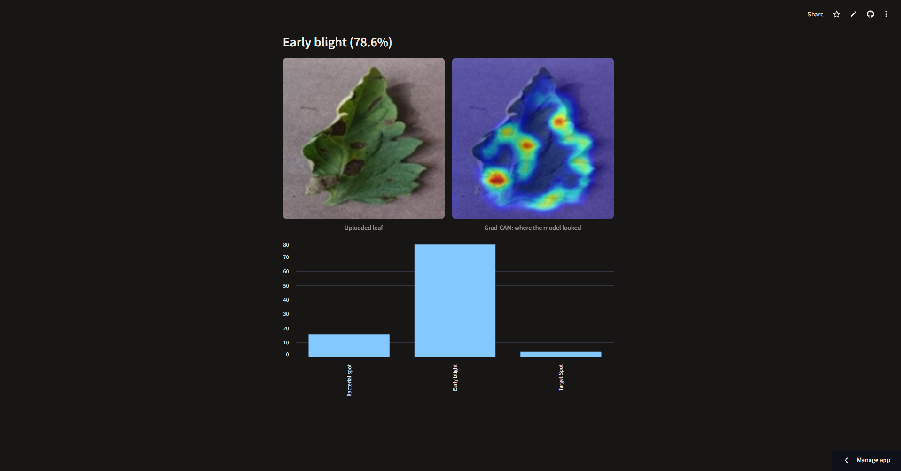
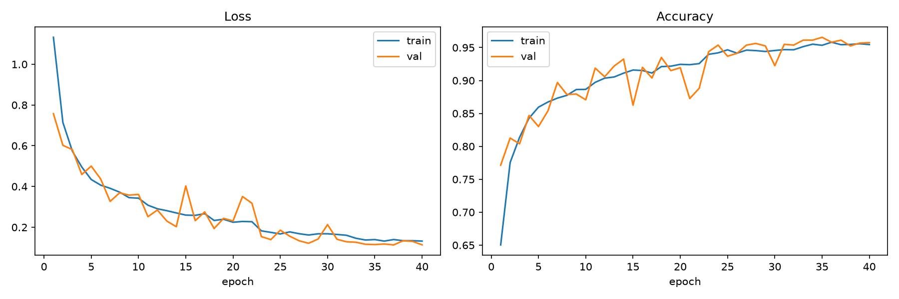
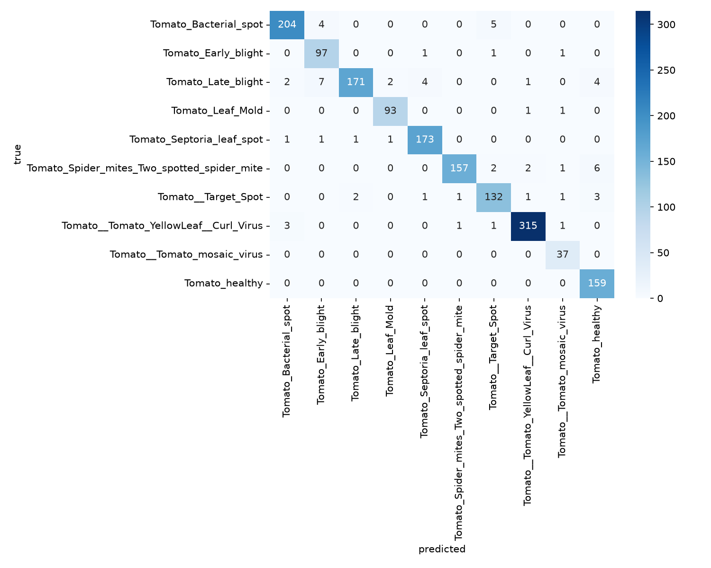
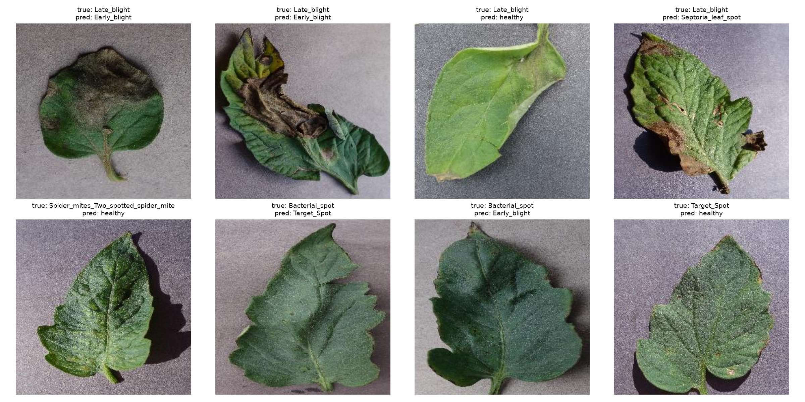
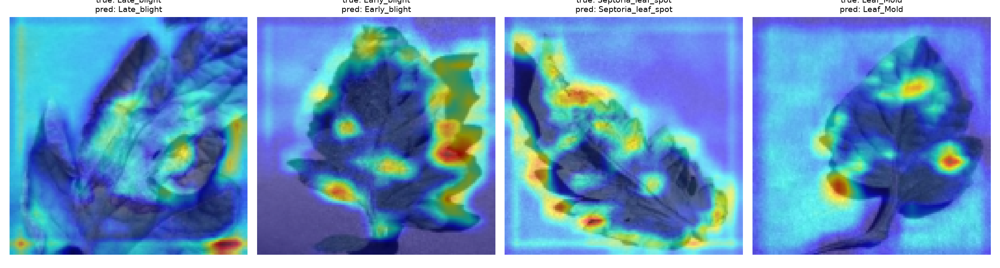
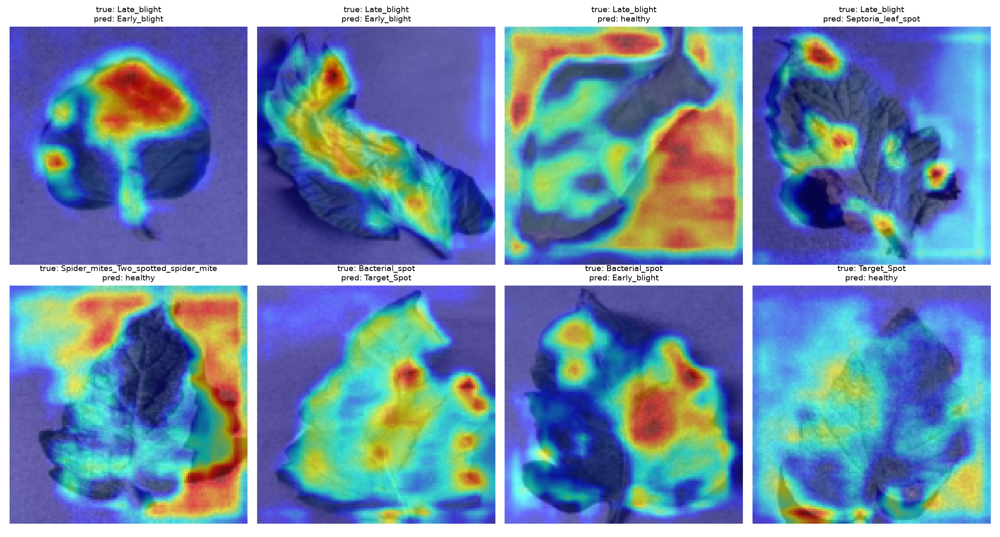

# 🍅 Tomato Leaf Disease Classifier (CNN from scratch + Grad-CAM)

A convolutional neural network built **from scratch in PyTorch** (no transfer learning) that classifies tomato leaf photos into 10 classes (9 diseases + healthy), with Grad-CAM heatmaps that show which parts of the leaf influenced each prediction.

**🔗 Live demo:** https://gill-tomato-leaf-disease.streamlit.app
*(The app sleeps after a period of inactivity. If it shows a "wake up" button, click it and wait a few seconds.)*



## Results

Evaluated once on a held-out test set of 1,602 images (the test set was never used for tuning).

| Metric | Value |
|---|---|
| Test accuracy | **96.0%** |
| Macro F1 | 0.955 |
| Macro precision | 0.949 |
| Macro recall | 0.963 |
| Best validation accuracy | 96.1% (epoch 37) |

The baseline model (15 epochs, no learning-rate schedule) reached 93.1% validation accuracy. Longer training with a learning-rate scheduler and early stopping took it to 96.1%.




### Where the model struggles
- **Late blight** has the lowest recall (0.895). It is most often confused with **Early blight** (7 cases).
- **Early blight** precision is 0.890 as a result of that confusion.
- **Healthy** precision is 0.924: 13 diseased leaves were predicted as healthy.
- **Tomato mosaic virus** has the lowest precision (0.881) and very few samples (37).



## Grad-CAM: what the model looks at

Grad-CAM is computed on the last convolutional block (`bn3`).

- On correct predictions, the heatmap mostly lands on the lesions.
- On errors where a diseased leaf was predicted as healthy, the attention drifted to the background instead of the lesion.




## Model and training

- **Data:** PlantVillage, tomato classes only (about 16,000 images, 10 classes), stratified 80/10/10 train/val/test split (seed 42)
- **Input:** 128×128, ImageNet mean/std normalization
- **Augmentation (train only):** horizontal flip, rotation (15°), RandomResizedCrop (scale 0.8–1.0)
- **Architecture:** 3 conv blocks (32 → 64 → 128 channels, each with BatchNorm, ReLU, MaxPool), adaptive average pooling, dropout 0.3, linear classifier
- **Training:** Adam (lr 1e-3), up to 40 epochs, ReduceLROnPlateau (factor 0.5, patience 3), early stopping (patience 7, on validation loss)
- **Framework:** PyTorch, with `grad-cam` for heatmaps and Streamlit for the app

## Limitations

- **Lab images vs real fields.** PlantVillage photos are mostly single leaves on plain backgrounds. On a field photo with a hand and busy background, the model got the class right but its Grad-CAM hotspots landed partly on the leaf edge, not only the lesions. Performance on real-world photos is likely lower than the test accuracy above.
- **Tomato only.** It cannot recognize other crops, and it has no "not a leaf" option, so any image will get a tomato-disease prediction.
- **Grad-CAM is an explanation aid, not proof** that the model reasons like a plant pathologist.
- **Not a diagnostic tool.** Do not use it to make real treatment decisions.

## Run locally

```bash
git clone https://github.com/Harshit-Gill/plant-disease-cnn.git
cd plant-disease-cnn
pip install -r requirements.txt
streamlit run app.py
```

The trained weights (`best_improved.pt`) and `class_names.json` are included. To retrain, download the PlantVillage dataset from Kaggle, place the tomato class folders in `PlantVillage/`, and run `main.ipynb`.

## Repository contents

| File | What it is |
|---|---|
| `app.py` | Streamlit app (upload, prediction, top-3 chart, Grad-CAM) |
| `main.ipynb` | Data pipeline, training, evaluation, Grad-CAM analysis |
| `best_improved.pt` | Final model weights |
| `class_names.json` | Class order used in training |
| `samples/` | One test image per class for trying the app |

## Author

Harshit Gill, B.Tech AIML
GitHub: [Harshit-Gill](https://github.com/Harshit-Gill)